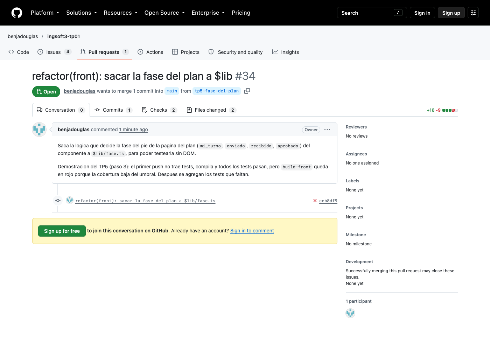
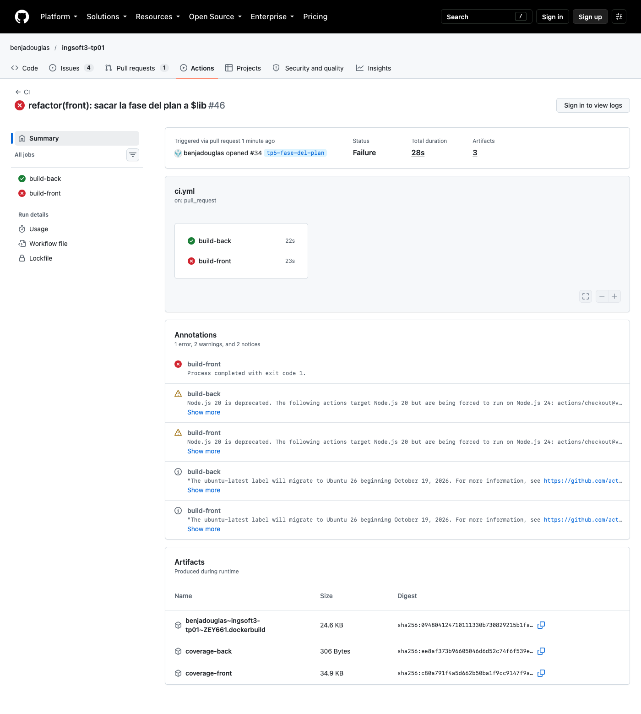
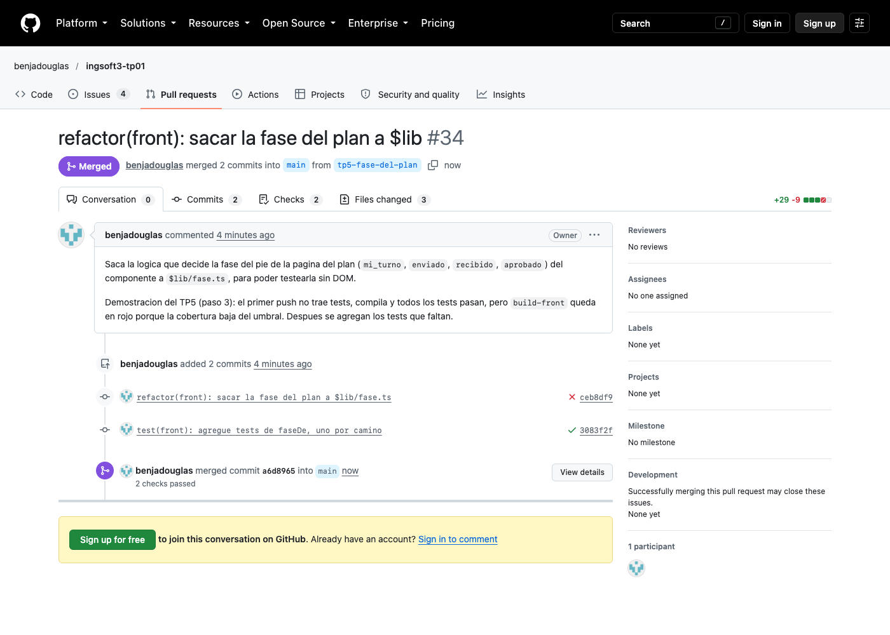
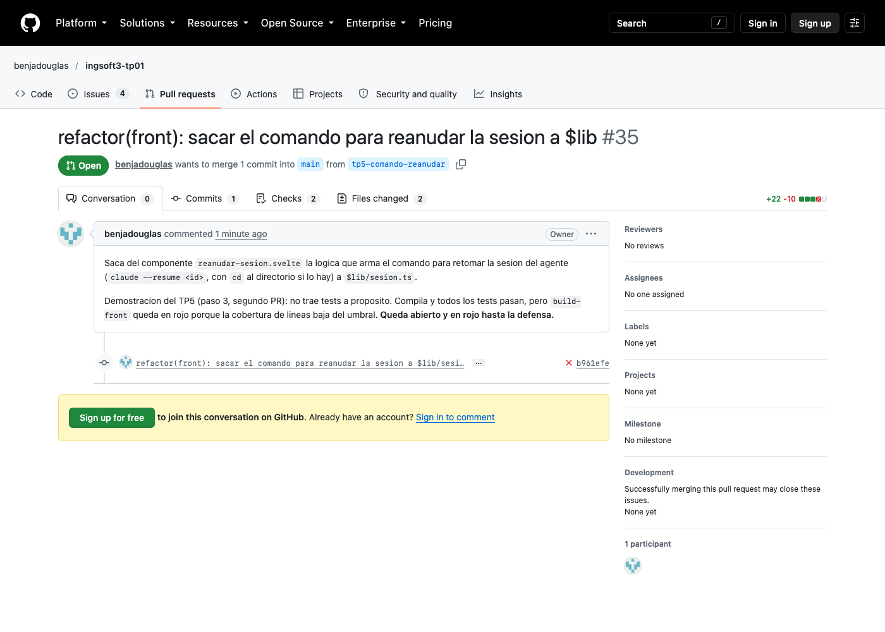
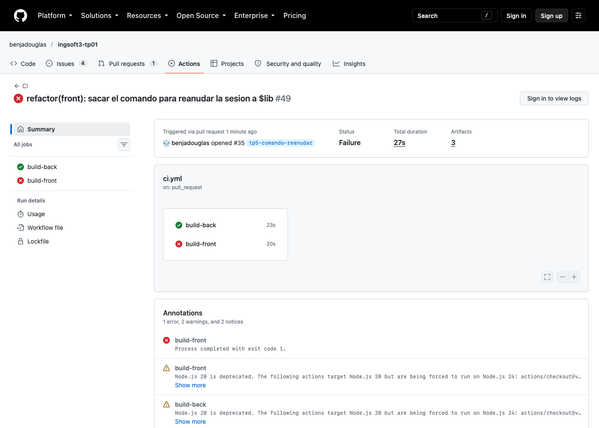
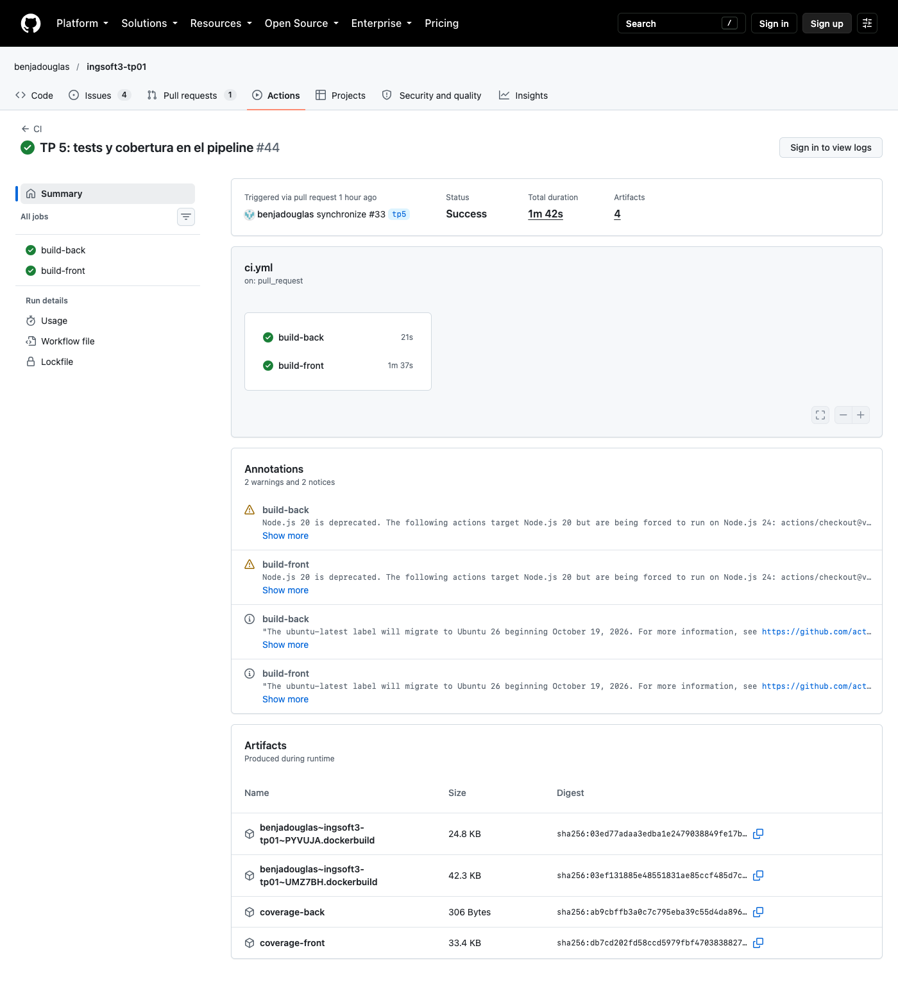

# TP 1

1. Porque es una decision tuya
2. Ninguno
3. Ninguna

# TP 2

Voy a hacer una aplicacion para que los agentes suban sus planes en archivos html y los muestren.
El usuario da feedback a esos planes mediante anotaciones o artefactos.
Se genera un loop entre agente y usuario hasta que este listo. El usuario commitea el plan y agente implementa

Elegi esto porque quiero aprovechar a hacer algo que me sirva pero que no sea complejo

> Decisiones de contenerización

1. Elegi como imagenes base:
- `/back`: multi-stage con dos etapas (dependencias + ejecutar)
- `/front`: multi-stage con dos etapas (build + ejecutar) (es mas simple porque es html y js estatico)
- Base de datos `postgres`


2. Persistencia  

Lo unico que persiste es la información de la base de datos (en un volumen `db_data`)

> Problemas encontrados

- Puse las variabesl .env entre comillas "", esto me causaba errores
- Configuar el token write:package
- La contraseña de la base de datos utilizaba caracteres especiales que interferian en la url. La solución fue poner `PGPASSWORD: ${DB_PASSWORD}` en docker-compose

# TP 3

> Decisiones de planificación

1. Elegi un sprint de 2 semanas porque coincide con el ritmo de entregas de la materia. Tambien evita mantener ramas abiertas durante mucho tiempo.

2. El limite de `In Progress` es 2. Trabajo solo: puedo tener un item activo y otro si el primero queda esperando una revision o respuesta. Un limite mayor me haria empezar muchas cosas sin terminarlas.

> Historia mal escrita

`Como desarrollador quiero crear la tabla usuarios para guardar los datos` es una tarea tecnica, no una historia. Describe como implementarlo pero no el valor para el usuario.

La reescribiria como: `Como usuario quiero crear una cuenta para guardar mis planes y volver a consultarlos`. Crear la tabla quedaria como una tarea.

> Problemas encontrados

- El projecto de GitHub se creo vacio. Los issues se tienen que agregar manualmente.
- La sesion de `gh` estaba vencida. Para seguir hay que renovarla con permisos de repositorio y Projects.

> Uso de IA

Use IA para interpretar la guia, preparar los issues y redactar estas decisiones. La verificacion final consiste en comparar el resultado con los requisitos del TP y revisar la jerarquia, el sprint, el tablero y el cierre automatico de la tarea.

# TP 4

> Estructura del pipeline

1. Dos jobs, `build-back` y `build-front`, uno por Dockerfile. Corren en paralelo porque no dependen entre si y asi el pipeline tarda lo que tarda el mas lento, no la suma. Si uno falla el otro sigue y veo enseguida cual imagen se rompio.

2. Corre en `pull_request` y en `push` a `main`. El PR verifica el cambio antes de entrar. El push verifica el merge final y es lo que alimenta el badge.

> Que cachea

Uso `type=gha` con `mode=max` para guardar tambien las capas de las etapas intermedias. Cada job tiene su propio `scope` para que back y front no se pisen.

- Se reutilizan: `FROM`, `COPY package.json bun.lock` y `RUN bun install` mientras no cambie el lockfile.
- No se reutilizan: `COPY src` en el back y `COPY . .` + `bun run build` en el front, cualquier cambio de codigo las invalida.

Si el cache desaparece el build no falla, solo tarda mas porque reconstruye todo. Paso de unos 20 segundos por job a mas de un minuto.

> Por que construir con el Dockerfile

Si el pipeline compila por su cuenta con `bun install` y `bun run build` estoy verificando una receta distinta a la que despues se despliega. Puede pasar el pipeline y fallar la imagen. Usando el Dockerfile se verifica exactamente lo que corre en produccion.

> Gate

`main` exige dos cosas para aceptar un merge: PR obligatorio (TP1) y los checks `build-back` y `build-front` en verde, con `strict: true` para que la rama este al dia con `main` antes de mergear. La secuencia rota -> bloqueado -> fix -> verde -> merge esta en el PR #15.

> Problemas encontrados

- El primer intento de romper el build cambio el destino del `COPY` (`./srcc`). Eso no rompe el build, rompe en runtime. Lo cambie por un origen inexistente (`COPY srcc ./src`).
- La primera corrida en `main` no mostro `CACHED` aunque el PR ya habia subido el cache. El cache de GitHub Actions esta aislado por rama: una corrida solo lee el de su rama o el de `main`. Recien despues del push a `main` los PRs empezaron a reutilizarlo.
- El workflow del TP3 corria tests. Este TP pide solo build, asi que los saque.

> Uso de IA

Use IA para interpretar la guia, escribir el workflow, hacer la demo del gate y redactar estas decisiones. Lo verifique mirando los logs de Actions (las lineas `CACHED` y el error del build roto), el estado `BLOCKED` del PR y la configuracion de la rama con `gh api`.

# TP 5

> Lógica de testeo

Primero borre los tests que tenia de antes para hacerlos como me pedia la guia. Luego busque las reglas de negocio o 'decisiones' que tomaba mi aplicacion para testearlos en 'isolation' en el archivo `back/src/services/reglas.ts`. A proposito no se mockeo drizzle porque iba a ser un 'sobre-mock'.

Algunas de las funciones testeadas:

- `esTurnoDe` y `estadoTras`: si fallan, el agente publica mientras el usuario comenta o un `refine` aprueba el plan.
- `esMismaSesion`: evita que otra sesion de agente tome un plan ajeno. Estaba copiada tres veces.
- `hayQueEntregar`: si el agente se cae despues de recibir el `implement`, al reconectar lo tiene que recuperar. Es la condicion mas facil de escribir mal.

En el front testee el `load` de la pagina del plan, que es la pantalla principal: que muestre solo los comentarios pendientes de la version actual y que de 404 cuando corresponde. Tambien `haceCuanto`, donde el test encontro que una fecha invalida se mostraba como "recien".

> Umbral de coverage

En el back tenemos un umbral de 0.9 (minimo 90%) de coverage sobre lineas y funciones. Hoy mide 100% en las dos: como todas las reglas fueron extraidas a `back/src/services/reglas.ts`, enfocamos los tests en ese archivo y es mucho mas facil cubrirlo entero. Bun no mide ramas, asi que en el back no hay numero de rama.

En el front tenemos un umbral de 50 (minimo 50%) sobre lineas y ramas. Cuando lo elegi media 51,35% de lineas y 61,9% de ramas (vitest 4.1.11). El numero es bajo porque `auth-client.ts`, `plan-html.ts`, `utils.ts` y el `+page.ts` de `/planes` entran en la cuenta y no tienen tests. Lo puse apenas por debajo de lo medido para que me frene si baja. Despues del PR #34 y del test del camino sin cubrir mide 55% de lineas y 74,07% de ramas.

> Que quedo afuera de la cobertura

Back: bun solo cuenta los archivos que algun test importa, y el unico que se importa es `reglas.ts`. Asi que la exclusion no la configure con `coveragePathIgnorePatterns`, sale de como mide bun. Lo que queda afuera es:

- `index.ts`, `app.ts` y `auth.ts`: el arranque y la configuracion de better-auth. No tienen reglas, si estan mal la app no levanta.
- `db/index.ts`, `db/schema.ts` y `db/auth.schema.ts`: la conexion, las tablas y el schema que genera better-auth.
- `services/acciones.ts`, `planes.ts`, `apiKey.ts` y `eventos.ts`: consultan y guardan con drizzle. Las reglas que tenian las saque a `reglas.ts` antes de dejarlos afuera, si no el 100% estaria midiendo una sola regla y escondiendo el resto.

El riesgo es que si alguien escribe una regla nueva directo en `acciones.ts` el numero sigue en 100% aunque no tenga tests.

Front: en vitest se dice que entra en la cuenta. Entran `src/lib/**/*.ts` y los `+page.ts` de las rutas. Quedan afuera:

- Los componentes `.svelte`: el markup y el CSS no tienen reglas, y la logica que si tienen (la pagina del plan decide si es tu turno y maneja los comentarios sobre cada bloque) depende del DOM. No entra en un unit test en node, la dejo para los e2e del TP7.
- `src/lib/components/ui`: lo genero shadcn.
- Los `*.test.ts`.

`auth-client.ts`, `plan-html.ts`, `utils.ts` y el `+page.ts` de `/planes` si cuentan y hoy estan en 0%. Por eso el front da 55% y no mas.

> Por que coverage alto no garantiza calidad

Porque el coverage mide que lineas se ejecutaron, no que comportamiento se verifico. "coverage mide ejecución, no verificación"

El ejemplo es mi propio back: da 100%. Si el test de `esTurnoDe` llamara a la funcion sin ningun `expect`, el 100% seguiria igual y no verificaria nada (por eso el front tiene `requireAssertions: true`). Y aun con asserts, el 100% es de `reglas.ts` solamente: una regla nueva escrita en `acciones.ts` no baja el numero.

Lo que si dice algo es romper el codigo a proposito: cambiar `||` por `&&` en `hayQueEntregar` pone 2 tests en rojo, y sacar el chequeo de los comentarios en el `load` del plan pone en rojo el test nuevo. Eso es un mutante muerto; el porcentaje no lo ve.

> El PR bloqueado

PR #1: https://github.com/benjadouglas/ingsoft3-tp01/pull/34

Saque la logica que decide la fase del pie de la pagina del plan (`mi_turno`, `enviado`, `recibido`, `aprobado`) del componente a `$lib/fase.ts`, sin tests. Compila y los 11 tests pasan, pero `build-front` se puso en rojo en las dos metricas (vitest 4.1.11): https://github.com/benjadouglas/ingsoft3-tp01/actions/runs/39506827926

```
ERROR: Coverage for lines (47.5%) does not meet global threshold (50%)
ERROR: Coverage for branches (48.14%) does not meet global threshold (50%)
```

Frena en las dos porque en vitest 4 una funcion que nadie llama tambien suma sus ramas sin cubrir. `build-back` quedo verde, el codigo nuevo era todo del front, y con un solo required en rojo el merge queda bloqueado.

Para arreglarlo escribi un test por cada camino de `faseDe` (un `it.each` con user_turn, agent_turn sin entregar, agent_turn entregado y approved). Volvio a verde (55% lineas, 70,37% ramas) y lo mergee.

PR #2: https://github.com/benjadouglas/ingsoft3-tp01/pull/35

Saca el armado del comando para reanudar la sesion del agente a `$lib/sesion.ts`, sin tests. Queda en rojo por lineas (47,82% contra 50; las ramas quedan en 57,57%) y abierto hasta la defensa: https://github.com/benjadouglas/ingsoft3-tp01/actions/runs/39507383270

En el back esta demostracion no se puede hacer con un archivo nuevo: bun solo mide lo que importan los tests, asi que un servicio nuevo sin tests no aparece en la cuenta y el check queda verde. Tendria que ir adentro de `reglas.ts`.

> Refactor para poder mockear

`generarApiKey` creaba la clave y la guardaba directo con `db.update(user)`. Para testearla habia que tener un Postgres andando, y ademas importar `db/index.ts` corta la ejecucion si no hay `DATABASE_URL`.

La parti en dos. `nuevaApiKey` en `reglas.ts` genera la clave y recibe desde afuera la funcion que guarda el hash. `generarApiKey` en `apiKey.ts` le pasa la de drizzle. En el test le paso un `mock()` y verifico que se guardo una sola vez el `sha256` de la clave y nunca la clave en texto plano, y que si el guardado falla la clave no se devuelve.

No mockee drizzle: tendria que simular toda la cadena `update().set().where()`, y el test terminaria verificando como uso drizzle en vez de la regla.

> Mi stack

| Fila | Back (bun) | Front (vitest 4.1.11) |
|---|---|---|
| Parametrizado | `test.each` de `bun:test` | `it.each` |
| Doble | `mock()` de `bun:test` | `vi.fn()` para `fetch` y `vi.mock("$lib/plan-html")` |
| Medidor de cobertura | `bun test --coverage` | `@vitest/coverage-v8` |
| Umbral que frena | `coverageThreshold` en `bunfig.toml` | `coverage.thresholds` en `vite.config.ts` |
| Filtro de que entra | implicito: solo los archivos importados por los tests | `coverage.include` / `coverage.exclude` |

Bun no mide ramas, solo lineas y funciones. El numero de rama lo da el front.

> Tests en el pipeline

Los tests corren como steps de `build-back` y `build-front`, antes del build de la imagen, y no como una etapa del Dockerfile. Asi si no se llega al umbral se ponen en rojo los mismos checks que ya eran required desde el TP4, sin configurar nada mas. Y el Dockerfile del back instala con `--production`, una etapa de tests necesitaria las dependencias de desarrollo dentro de la imagen.

Para que lo testeado sea lo mismo que se despliega fije las mismas versiones que los Dockerfiles: bun 1.3 (`oven/bun:1.3-alpine`) y vite-plus 0.3.0.

La tabla de cobertura queda en el summary de cada corrida y el reporte completo se sube como artifact (`coverage-back` y `coverage-front`), las dos cosas tambien cuando el umbral falla: https://github.com/benjadouglas/ingsoft3-tp01/actions/runs/39494888477

> Ejercicio del camino sin cubrir

El reporte del front marcaba dos ramas sin cubrir en `routes/planes/[id]/+page.ts`:

- Linea 41, `if (!comentarios.ok) error(...)`: el camino donde la API del plan responde bien pero la de comentarios falla. La recorre un `fetch` que devuelve el plan y la lista pero un 500 (o 404) en `/api/planes/p1/comentarios`. Lo agregue: si ese chequeo se borra, la pagina intenta leer como lista de comentarios la respuesta de error y falla con un error confuso en vez del status que devolvio la API. Probe sacar la linea y el test nuevo se pone en rojo.
- Linea 50, `plan.harness ? {...} : null`: el plan con `harness: "claude-code"`. Esa no la agregue: solo copia campos a un objeto, el test verificaria que una propiedad guarda un valor.

> Problemas encontrados

- Los tests que tenia eran de integracion (contra Postgres) y de browser (Chromium). Los borre y saque el proyecto de browser con Playwright de `vite.config.ts`, la suite nueva corre en node.
- Puse `0.9` como threshold en vitest pensando que era 90%. En vitest es porcentaje (`90`), en bun es fraccion (`0.9`).
- `vp test run` sin `--coverage` no evalua los thresholds, pasa siempre.
- En el CI la salida pasa por `tee` para armar el summary. Sin `shell: bash` (que activa `pipefail`) el step terminaba con el codigo del `tee` y quedaba verde aunque no se llegara al umbral.
- En Actions bun imprime cada test ademas de la tabla, y el summary quedaba lleno de ruido. Filtre solo las lineas de la tabla con `grep '|'`.
- El test de `haceCuanto` encontro que una fecha invalida se mostraba como "recien". Ahora devuelve `""`.
- Las capturas de GitHub sin sesion iniciada no muestran el summary ni los logs. La evidencia del numero esta en las URL de las corridas.
- En la tabla de texto de vitest no aparecen los archivos con 100% (`fecha.ts`, `fase.ts`). No es que no se midan, el total los incluye.

> Uso de IA

Use IA para elegir que reglas testear, extraerlas a `reglas.ts`, escribir los tests, configurar la cobertura y el workflow, armar los dos PR de la demostracion y redactar parte de estas decisiones. Lo verifique corriendo las suites en local, cambiando un `||` por `&&` en `hayQueEntregar` para ver que algun test se pone en rojo, subiendo el umbral a 99 para ver que el comando falla, y mirando el summary y los artifacts de la corrida en Actions.

> Enlaces

- Summary y reporte descargable: https://github.com/benjadouglas/ingsoft3-tp01/actions/runs/39494888477
- Corrida roja por umbral: https://github.com/benjadouglas/ingsoft3-tp01/actions/runs/39506827926
- PR #1 (rojo, tests, verde, merge): https://github.com/benjadouglas/ingsoft3-tp01/pull/34
- PR #2 (abierto y en rojo): https://github.com/benjadouglas/ingsoft3-tp01/pull/35

Capturas en `img/tp5/` (vista publica, sin sesion):







